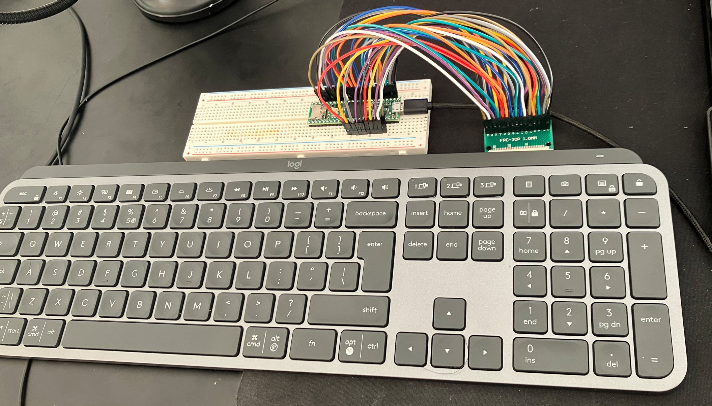
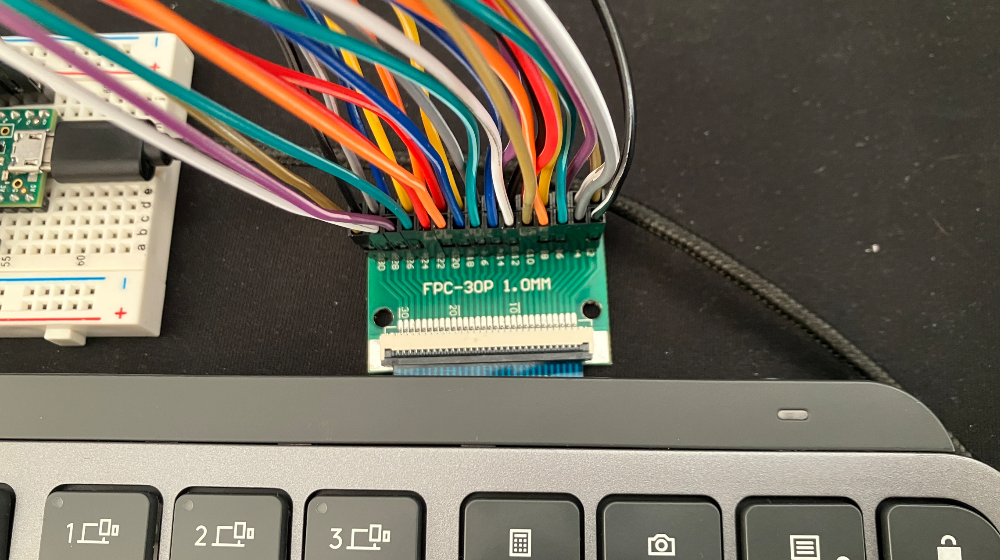

# logitech-mx-keys-wired

Make the Logitech MX Keys work via wired connection, 8000Hz USB pooling rate, ~0.1 ms latency




> This project is built on top of [Frank Adams' USB Laptop Keyboard Controller](https://github.com/thedalles77/USB_Laptop_Keyboard_Controller) and [Marcel Hillesheim's matrix generator](https://github.com/thedalles77/USB_Laptop_Keyboard_Controller-1/blob/master/matrixgenerator.py).

> :warning: Please note this is an independent hobby project and is not affiliated with, endorsed by, or sponsored by Logitech.

## Status

Currently Working: 
- [x] full keyboard matrix (letters, numbers, punctuation, F-row, arrows, numpad, navigation cluster, all modifiers) decoded
- [x] whole prototye running as a USB keyboard with low-latency eager debounce; 
- [x] Caps Lock LED works, both on the Teensy and on the Caps Lock key itself; 
- [x] the top-row media and shortcut keys, Fn-lock, the Mac/Windows mode switch, work
- [x] settings saved across reboots.
- [x] 8000Hz USB pooling and ~72 µs keyboard scan rate

Not done yet: 
- [ ] working backlight (and the F5/F6 backlight decrease/increase keys)
- [ ] proximity sensor (which triggers backlight on when hands get close)
- [ ] light sensor?
- [ ] convert the prototype into a PCB with soldered components that can fit into the old PCB's place
- [ ] MX Keys mini support?
- [ ] MX Keys S support?
- [ ] ?maybe? create a followup version that brings back bluetooth (besides wired-support)

## Hardware Requirements

You'll need a Logitech MX Keys that you love, find yourself returning to, and at the same time loathe and hate that it doesn't work in wired mode. And in my case I used the following components:
- Teensy 4.1 board
- A 30-pin 1.0mm FPC breakout/adapter (you can get from ali express)
- Cables to connect to headers (at least 30)
- micro-USB to USB cable

If you use the FPC adapter or the Teensy 4.1 board without headers, you'll also need:
- PCB Pin Header connectors
- A Soldering iron to solder the headers onto the , if you bought the 30pin fpc adapter without headers


## Wiring (FPC pin to Teensy 4.1 pin)



Basically you need to wire all 30 FPC pins straight across using the table below (this is the con_pin_v4_1 array inside matrixgenerator.py). Teensy I/O pin 13 is never used because it drives the on-board LED.

```
FPC  Teensy     FPC  Teensy     FPC  Teensy
 1    23        11    18        21    10
 2     0        12     5        22    11
 3    22        13    17        23    12
 4     1        14     6        24    24
 5    21        15    16        25    25
 6     2        16     7        26    26
 7    20        17    15        27    27
 8     3        18     8        28    28
 9    19        19    14        29    29
10     4        20     9        30    30
```

Use the adapter's own pin-1 marking consistently everywhere (wiring, decoder output, and the key-list file). Pins 26-30 are not part of the key matrix; they carry some key indicator LEDs.

## Build process

### 0. Toolchain setup (arduino-cli)

```bash
curl -fsSL https://raw.githubusercontent.com/arduino/arduino-cli/master/install.sh | sh
mv bin/arduino-cli /usr/local/bin/.

arduino-cli config init --overwrite --additional-urls https://www.pjrc.com/teensy/package_teensy_index.json
arduino-cli core update-index
arduino-cli core install teensy:avr
arduino-cli core install arduino:avr

arduino-cli board list   # confirm the Teensy shows up
```

You'll also need Python, I recommend installing [uv](https://docs.astral.sh/uv/).

### 1. Decode the matrix 

Flash the decoder as a USB keyboard:

```bash
arduino-cli compile --fqbn teensy:avr:teensy41:usb=keyboard tools/Matrix_Decoder_4p1
arduino-cli upload  -p usb:<your-teensy-port> --fqbn teensy:avr:teensy41:usb=keyboard tools/Matrix_Decoder_4p1
```

(`arduino-cli board list` prints the teensy port, e.g. `usb:2110000`.)

Open a plain-text editor, make a copy of a template from `tools/templates/` (or use the
filled-in `data/MX_Keys.txt` as a reference), click at the end of the first key's line, and
press each physical key once, in list order. The decoder types the two FPC pins it detects
(separated by a tab) and sends a down-arrow to advance. Press one key at a time and release
fully; do not roll across a row. A good read is always two different pins.

### 2. Generate the matrix

```bash
uv run tools/matrixgenerator.py
# enter the path to your recorded file (e.g. data/MX_Keys.txt)
# enter teensy index 4  (= Teensy 4.1)
# if asked for an output pin because the first two keys share no pin, give any one pin
```

It prints the Teensy input pins, output pins, and the KEY/MODIFIER/FN matrices.

### 3. Build and flash the controller

Paste the pin arrays and matrices into `firmware/MX_Keys_Controller/MX_Keys_Controller.ino`
(set `rows_max` to the number of output pins and `cols_max` to the number of input pins),
then:

```bash
arduino-cli compile --fqbn teensy:avr:teensy41:usb=keyboard,speed=150 firmware/MX_Keys_Controller
arduino-cli upload  -p usb:<your-teensy-port> --fqbn teensy:avr:teensy41:usb=keyboard,speed=150 firmware/MX_Keys_Controller
```

`speed=150` runs the CPU at 150 MHz instead of the default 600 MHz. The firmware scans
continuously, so at 600 MHz the chip sits warm all day; at 24 MHz a scan is slower than the
125us USB poll and wastes the 8000Hz polling. 150 MHz keeps a full scan well under one poll.

If an upload fails with a Teensy Loader status error, retry once, or press the Teensy's
button to force the bootloader and upload again.

## This keyboard's result (MX Keys full-size)

The matrix solved cleanly into 25 used pins (26-30 are for the Caps-lock and 1-3 Device change indicator LEDs), split as:

- Input pins (read with pullups), Teensy: `23, 0, 22, 1, 21, 2, 20, 3, 19, 4, 18, 5, 17, 6, 16, 7`
- Output pins (driven low one at a time), Teensy: `15, 8, 14, 9, 10, 11, 12, 24, 25`

So `rows_max = 9` (outputs) and `cols_max = 16` (inputs).

### Indicator LEDs (FPC 26-30)

The small LEDs on the Caps Lock and Easy-Switch keys sit on the same 30 pin FPC, common anode:

```
FPC/Teensy  LED
   26       common anode (+)
   27       computer 1 (cathode)
   28       computer 2 (cathode)
   29       computer 3 (cathode)
   30       Caps Lock  (cathode)
```

Found with `tools/LED_Probe`, which steps through every pin pair through a weak pullup and prints the active pair over serial; compile it with `usb=serial` and reflash the controller afterwards.

## Firmware design and tuning

You can find the code for the firmware on [firmware/MX_Keys_Controller/MX_Keys_Controller.ino](firmware/MX_Keys_Controller/MX_Keys_Controller.ino)

- Scan: drive each row (output pin) low in turn, read every column (input pin) with a pullup. Keys read low when pressed (negative logic).
- The firmware only sends a USB report on a confirmed state change, never on a steady state.
- The matrix is scanned back to back with no delay. At 150 MHz a scan measures ~72us on average (about 13,900 scans/s), under 80us at worst while typing and under 100us while holding chords.
- Debounce is eager and per-key: a press or release is sent the instant it is first seen, then that key is locked out for `DEBOUNCE_US` so contact bounce is ignored. Debounce adds no latency to the change itself and does not drop fast or glancing taps.
- USB polling is 8000Hz: Teensy 4.1 runs at USB high speed (480 Mbit), and the Teensyduino keyboard endpoint asks for a poll every microframe (125us). Key-to-host latency is at most one scan plus one poll: ~0.2ms worst case, ~0.1ms on average. The media-key interface is polled at 1000Hz.
- Anti-ghosting: the matrix has no diodes, so with three keys down at the corners of a rectangle the fourth corner reads pressed too (J+K+; also shows "."). The whole matrix is read before any change is acted on, and a press that closes such a rectangle is held back until the rectangle breaks. A press that might be a ghost (two of the other three corners down, the third maybe bouncing) waits 1ms first; ordinary typing and rolls are not delayed.
- Rollover: 6KRO (the USB boot-protocol 6-key method) plus modifiers.
- USB names: `usb_names.c` makes the board show up as "MX Keys" by "MX Keys Wired" instead of "Keyboard" by "Teensyduino". The vendor/product IDs stay the Teensy ones, so uploads still reboot the board by themselves.

Tuning knobs in the sketch:

- `#define DEBOUNCE_US 4000` - lockout length in microseconds. Lower (2000-3000) for a tighter
  window, raise if a worn switch chatters.
- `#define ROW_SETTLE_US 3` - how long a row is held low before its columns are read. Raise it
  if keys are missed or read in the wrong row.
- `#define GHOST_HOLD_US 2000` / `GHOST_CONFIRM_US 1000` - anti-ghosting windows. Raise them if
  a phantom key still slips through when holding several keys.
- `#define LATENCY_DEBUG 0` - set to 1 to measure the scan. Once a second the firmware prints
  scans per second plus the average and worst scan time and time between scans. Read it with
  `uv run tools/latency_monitor.py` (reads the Teensy serial emulation channel). Set it
  back to 0 afterwards.

## Top row keys

The top row follows the MX Keys legends of my MX keys. By default each key does its printed action; and I hold Fn to get the plain key in the last column instead.

| Key | Windows | Mac | Fn |
|---|---|---|---|
| F1 / F2 | screen brightness down / up | same | F1 / F2 |
| F3 | task view (Win+Tab) | Mission Control (Ctrl+Up) | F3 |
| F4 | Start menu (Win tap) | F4 (bind "Show Launchpad" to it) | F4 |
| F5 | action centre (Win+A) | F5 | F5 |
| F6 / F7 | F6 / F7 (backlight keys once the backlight is wired) | same | F6 / F7 |
| F8 / F9 / F10 | previous / play-pause / next | same | F8 / F9 / F10 |
| F11 / F12 / volume key | mute / volume down / volume up | same | F11 / F12 / - |
| computer 1 / 2 / 3 | F13 / F14 / F15 (bind in software) | same | - |
| calculator | calculator app | same | - |
| camera | snip (Win+Shift+S) | area screenshot (Cmd+Shift+4) | Print Screen |
| menu | context menu key | same | Scroll Lock |
| lock | lock screen (Win+L) | lock screen (Ctrl+Cmd+Q) | - |

Media actions come from the `consumer[]` matrix and key combinations from the `shortcut[]` matrix and `shortcuts[]` table in the firmware. Screen brightness keys only work on displays the OS can dim (laptop panels); most external monitors ignore them. Each key remembers what its press sent and releases exactly that, so toggling Fn or OS mode while a key is held never leaves anything stuck.

Fn+Esc toggles Fn-lock, which flips the default for F1-F5 and F8-F12: they then send plain
F-keys and Fn+key does the printed action. The computer 3 key LED is lit while Fn-lock is on.

## OS mode and saved settings

Fn+P switches to Windows mode, Fn+O to Mac mode (the computer 1 / computer 2 LED flashes for a second to confirm). Mac mode remaps the modifiers to the MX Keys Mac legends: the Start key sends Option, left Alt sends Cmd, and right Alt sends right Cmd.

Fn-lock and OS mode are saved to the Teensy EEPROM whenever they change and restored at power-up. A fresh Teensy starts in Windows mode with Fn-lock off. The EEPROM layout is at the top of the sketch (`EE_*`, `SETTINGS_MAGIC`).

## Backlight (in progress)

The white backlight is not on the key-matrix FPC. It has its own two-wire lead: red (+) and
black (-). It is a series string of LEDs that needs about 27V: measured on a bench supply it
runs at about 26.9V and 10mA. A 5V source will not light it, not even dimly.

This matches the iFixit guide "Logitech MX Keys Mod for backlight all time on"
(https://www.ifixit.com/Guide/Logitech+MX+Keys+Mod+for+backlight+all+time+on/156544), which
uses a small adjustable boost converter to step USB 5V up to a fixed 27V for the backlight.
On 5V that setup draws about 70mA from the supply.

The plan here adds brightness control from the Teensy:

```
Teensy VIN (5V) --> boost IN+          boost OUT+ --> ~470 ohm --> RED (backlight +)
Teensy GND -------> boost IN-                                      BLACK (backlight -)
                                                                       |
                                                                     drain
Teensy pin 33 --> 100 ohm --> gate   [N-MOSFET, >= 50V]
                     gate --> 100k --> GND                          source --> GND
```

- Set the boost output to about 32V with no load connected first. The series resistor then sets
  the current, about (32 - 26.9)V / 470 ohm = 11mA. Feeding the string a fixed voltage with no
  resistor is touchy: small voltage or temperature changes swing the current a lot.
- The boost module must reach 32V or more (for example an XL6009). An MT3608 tops out at 28V.
- The MOSFET drain sits near the full boost voltage when the LEDs are off, so it needs a 50V or
  higher rating (BSS138, 2N7000, IRLZ44N). The common 30V logic-level parts are too close.
- Pin 33 is PWM-capable and not wired to the FPC. The 100k pulldown keeps the backlight off
  while the Teensy boots.

Firmware to follow: PWM brightness levels with a gamma curve, brightness keys, and the level
saved to EEPROM.

## Credits

- Frank Adams - USB Laptop Keyboard Controller and the Teensy 4.1 decoder sketches:
  https://github.com/thedalles77/USB_Laptop_Keyboard_Controller
- Marcel Hillesheim - the matrix generator, with Frank Adams' Teensy 4.1 additions
- Instructables writeup: https://www.instructables.com/How-to-Make-a-USB-Laptop-Keyboard-Controller/

## License

Apache License 2.0. See LICENSE. Derived software retains the upstream Apache 2.0 license.

Trademark Notice: Logitech and MX Keys are trademarks of Logitech. This is an independent hobby project and is not affiliated with, endorsed by, or sponsored by Logitech.